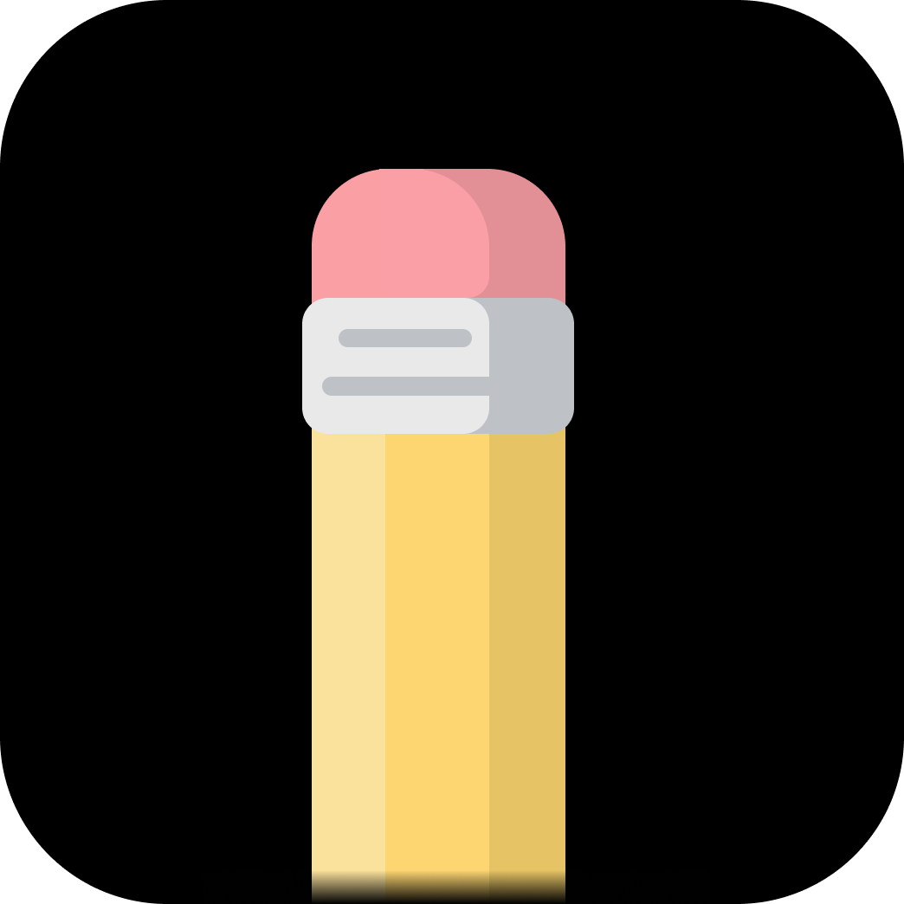

<p align="center">
  
</p>

<h1 align="center">Docket</h1>

<p align="center">A tiny note that lives in your Mac's Dock.<br>
Click the icon, and a note or checklist pops up right above it.</p>

---

## Features

- **Pops out of the Dock**: click the icon to open, click again (or anywhere else) to tuck it away
- **Note or checklist**: free text, or a to-do list with tick-off, inline editing, reorder and "Clear done"
- **Always saved**: every change is written to disk instantly
- **Move it anywhere**: drag the ☰ grip to detach it into a floating window that stays put; double-click the grip to snap it back
- **Resizable**: drag the corner, or use the **S / M / L** presets
- Native, tiny, no dependencies. Universal binary for Apple Silicon and Intel

## Install

1. Download the latest `Docket-x.y.z.dmg` from **[Releases](../../releases/latest)**.
2. Open it and drag **Docket** into **Applications**.
3. First launch: Docket isn't notarized by Apple, so macOS will block it the first time.
   Open **System Settings → Privacy & Security**, scroll down and click **Open Anyway**.
   (Or run `xattr -dr com.apple.quarantine /Applications/Docket.app` in Terminal.)
4. Right-click the Dock icon → **Options → Keep in Dock**. Optionally add it to
   **System Settings → General → Login Items**.

Requires macOS 13 Ventura or later.

## Where are my notes?

`~/Library/Application Support/Docket/note.json`. Back it up or sync it however you like.

## Build from source

Needs the Xcode Command Line Tools (`xcode-select --install`).

```sh
scripts/build.sh            # → build/Docket.app
scripts/package.sh 1.0.0    # → dist/Docket-1.0.0.zip and .dmg
scripts/make-icon.sh        # regenerate the icon from Resources/icon-source.png
```

## Releasing

Releases are built by GitHub Actions ([`.github/workflows/release.yml`](.github/workflows/release.yml)).
Tag a version and push it:

```sh
git tag v1.0.0
git push origin v1.0.0
```

The workflow builds a universal app, and publishes `Docket-1.0.0.dmg` and `.zip` as a GitHub Release.

## Project layout

```
Sources/Docket.swift          the whole app (SwiftUI + AppKit)
Resources/AppIcon.icns        app icon
Resources/icon-source.png     icon artwork (1024×1024)
scripts/build.sh              compile + assemble Docket.app
scripts/package.sh            zip + dmg for distribution
scripts/make-icon.sh          png → icns
.github/workflows/release.yml CI release on tag push
```

## License

[MIT](LICENSE)
